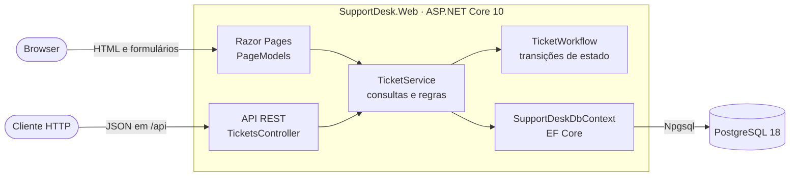
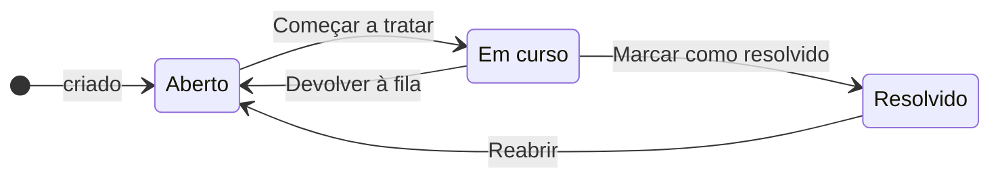
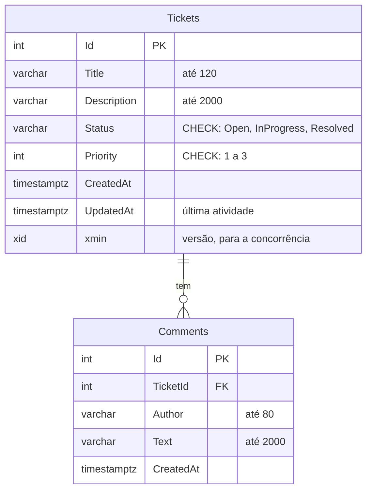

<div align="center">

# SupportDesk AI

**Pedidos de suporte com páginas web e API REST, a caminho de uma IA local que ajuda os técnicos a responder.**


</div>

O SupportDesk AI é uma aplicação para abrir, acompanhar e resolver pedidos de suporte informático. Os pedidos ficam numa base PostgreSQL e podem ser geridos pelas páginas web ou por uma API REST, que usam o mesmo serviço e as mesmas regras.

É um projeto pessoal de aprendizagem e portefólio, construído por fases. A base da aplicação está feita; a seguir vêm as contas de utilizador, os testes e a IA.

## 🎯 Objetivo

Uma aplicação de suporte em que os clientes abrem pedidos e os técnicos os tratam com a ajuda de um modelo de IA que corre na própria máquina (Ollama), para os dados não saírem para um serviço externo.

> **A IA sugere; o técnico decide.** Nenhuma resposta chega ao cliente sem ser revista por uma pessoa.

No fim, a aplicação vai ter:

- contas e permissões: o cliente vê só os seus pedidos, e o técnico trata de todos;
- classificação sugerida pela IA (categoria, prioridade e resumo) e resumo de conversas longas;
- uma base de conhecimento com pesquisa por palavras e por significado (embeddings);
- rascunhos de resposta com fontes citadas (RAG), sempre revistos por um técnico;
- avaliação da qualidade da IA com casos de teste e métricas;
- testes automáticos, Docker e integração contínua no GitHub Actions.

## ✨ O que já faz

**Pedidos**
- Criar pedidos com título, descrição e prioridade (Alta, Normal ou Baixa).
- Acompanhar o estado (Aberto, Em curso, Resolvido), com regras de transição e reabertura.
- Comentar. Cada mudança de estado fica registada como comentário do «Sistema», e um pedido resolvido só aceita comentários depois de reaberto.

**Páginas web**
- Lista com filtro por estado, pesquisa no título e na descrição, e paginação que mantém os filtros.
- Detalhe de cada pedido, com os comentários e botões só com as mudanças de estado permitidas.
- Formulários com validação no browser e no servidor, mensagens de confirmação e datas na hora de Lisboa.

**API REST**
- As mesmas operações em JSON, com filtros, ordenação e paginação.
- Erros em ProblemDetails, com códigos HTTP previsíveis.

**Robustez**
- Concorrência otimista: duas alterações ao mesmo pedido, ao mesmo tempo, não se apagam uma à outra.
- Proteção contra CSRF nos formulários e contra XSS nas páginas.

## 🧱 Arquitetura



As páginas e a API são dois clientes do mesmo serviço: a consulta, os filtros e as regras escrevem-se uma vez, e só muda a forma de responder (HTML ou JSON).

| Pasta | O que tem |
|---|---|
| `Pages/` | Razor Pages: lista, detalhe e criação de pedidos. Cada página tem a vista (`.cshtml`) e o PageModel |
| `Controllers/` | A API REST, em `/api/tickets` |
| `Contracts/` | DTOs de entrada e saída, com as regras de validação |
| `Services/` | `TicketService`: consultas, regras e gravação, usado pelas páginas e pela API |
| `Models/` | Entidades (`Ticket`, `Comment`) e as regras de estado (`TicketWorkflow`) |
| `Data/` | `SupportDeskDbContext` (EF Core) e os dados de exemplo |
| `Migrations/` | A evolução do esquema da base, migração a migração |
| `Infrastructure/` | Erros da API em ProblemDetails e a formatação dos dados nas páginas |

O código está em `src/SupportDesk.Web`. Na raiz, `experiencias/` e `01-schema.sql` são exercícios de aprendizagem e não fazem parte da aplicação.

### Ciclo de vida de um pedido



As transições permitidas estão num só sítio, o `TicketWorkflow`. A página usa-as para mostrar só os botões possíveis, e o serviço volta a verificá-las antes de gravar: uma página desatualizada, ou um pedido HTTP feito à mão, não passam.

### Modelo de dados



## 🧠 Decisões técnicas

- **Um serviço, dois clientes.** As páginas e a API chamam o mesmo `ITicketService`. Não há lógica duplicada entre o HTML e o JSON.
- **DTOs na fronteira.** A API e os formulários recebem e devolvem DTOs, nunca as entidades. Um cliente não consegue mexer em campos como o `Id` ou o `Status`, e a base pode mudar sem partir o contrato da API.
- **Regras num só sítio.** As transições de estado vivem no `TicketWorkflow`, e a validação do título (sem contar os espaços nas pontas) vive no DTO, com `IValidatableObject`. A API e as páginas usam as mesmas.
- **A base também se defende.** O estado e a prioridade têm restrições `CHECK` no PostgreSQL, e o estado guarda-se como texto, legível numa consulta SQL.
- **Concorrência otimista com `xmin`.** O PostgreSQL guarda em cada linha o id da transação que a escreveu, e o EF Core usa-o como versão. Se outra pessoa gravou entretanto, o `UPDATE` não afeta nenhuma linha e a aplicação avisa (409 na API), em vez de apagar a alteração dela. Não é preciso nenhuma coluna extra.
- **Post/Redirect/Get.** Depois de gravar, as páginas redirecionam: carregar F5 não repete a gravação, e a mensagem de confirmação passa pelo `TempData`.
- **Erros previsíveis.** A API responde sempre em ProblemDetails, sem detalhes internos: 400 com os erros por campo, 404, 409, e 503 quando a base não responde.
- **UTC na base, Lisboa no ecrã.** As datas guardam-se em UTC e só são convertidas na apresentação, com as regras da hora de verão.
- **Segredos fora do Git.** A ligação à base fica nos user-secrets; o repositório não tem palavras-passe.

## 🧰 Tecnologias

| Camada | Tecnologia |
|---|---|
| Plataforma | .NET 10, C# |
| Web | ASP.NET Core 10: Razor Pages e Web API (controllers) |
| Dados | EF Core 10 com Npgsql, PostgreSQL 18 |
| Interface | Bootstrap 5.3, validação no browser com jQuery Validation |
| Ferramentas | `dotnet-ef` (migrações), user-secrets, ficheiros `.http` |

## 🚀 Como correr

**Precisas de:** .NET SDK 10 e PostgreSQL 18.

```powershell
git clone https://github.com/pmrmoreira/SupportDesk.git
cd SupportDesk
dotnet tool restore
dotnet user-secrets set "ConnectionStrings:SupportDesk" "Host=localhost;Port=5432;Database=supportdesk;Username=postgres;Password=A_TUA_PALAVRA_PASSE" --project src/SupportDesk.Web
dotnet ef database update --project src/SupportDesk.Web
dotnet run --project src/SupportDesk.Web
```

1. `dotnet tool restore` instala o `dotnet-ef` na versão fixada no repositório.
2. `user-secrets` guarda a ligação à base fora do repositório. Troca `A_TUA_PALAVRA_PASSE` pela tua; se tiver `$`, usa aspas simples.
3. `database update` cria a base, as tabelas e três pedidos de exemplo.
4. `dotnet run` arranca a aplicação em **http://localhost:5011**.

**Experimentar:** as páginas estão em http://localhost:5011/Tickets. Para a API, abre `src/SupportDesk.Web/SupportDesk.http` no Visual Studio: tem pedidos prontos para listar, criar, comentar e mudar o estado.

<details>
<summary><b>Problemas comuns</b></summary>

| Erro | Causa | Solução |
|---|---|---|
| `Falta a ligação 'SupportDesk'` ao arrancar | A ligação à base não está nos user-secrets | Corre o `dotnet user-secrets set` de cima |
| `28P01:
