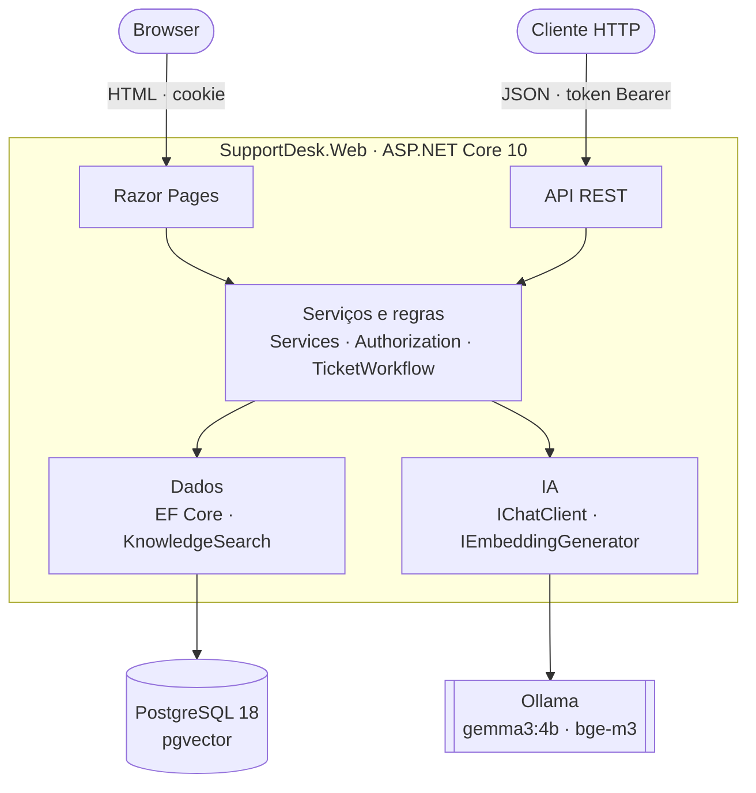

# SupportDesk AI

Aplicação de pedidos de suporte informático com um assistente de IA local. Os clientes abrem pedidos, os técnicos tratam-nos, e um modelo de linguagem a correr na própria máquina classifica pedidos, resume conversas e escreve rascunhos de resposta com fontes citadas.

A IA sugere e o técnico decide: nenhuma resposta chega ao cliente sem ser revista por uma pessoa, e os dados dos pedidos não saem para serviços externos.

## Funcionalidades

**Pedidos**

- Criar, editar, comentar e acompanhar pedidos, com estados (Aberto, Em curso, Resolvido) e regras de transição.
- Lista com filtro por estado, pesquisa, ordenação e paginação.
- Concorrência otimista: duas alterações simultâneas ao mesmo pedido não se sobrepõem.

**Contas e permissões**

- Registo e início de sessão com ASP.NET Core Identity.
- Clientes veem e comentam apenas os seus pedidos; técnicos tratam de todos.
- Páginas autenticadas por cookie e API autenticada por token Bearer.

**IA**

- Classificação: sugestão de categoria, prioridade e resumo, que o técnico aceita ou rejeita.
- Resumo de conversas: problema, ações já feitas e informação em falta, com orçamento de contexto para conversas longas.
- Rascunhos de resposta (RAG): o modelo responde apenas com trechos da base de conhecimento e cita a fonte de cada frase. As citações são verificadas pelo código, e o técnico edita e publica ou descarta.
- Cada chamada fica registada com o modelo, os tokens e a duração.

**Base de conhecimento**

- Artigos em Markdown, importados para o PostgreSQL e divididos em trechos.
- Pesquisa textual (tsvector, configuração `portuguese`), pesquisa semântica (pgvector) e pesquisa híbrida por Reciprocal Rank Fusion.

**Operação**

- Resiliência nas chamadas ao modelo: tempo limite, repetições com espera exponencial e disjuntor.
- Limite de pedidos à IA por utilizador e por minuto.
- Endpoint `/health` com o estado da base de dados e do Ollama.
- Página de utilização da IA e traços OpenTelemetry opcionais.
- Avaliação da qualidade da IA com casos de teste e métricas.

## Arquitetura



As páginas e a API são dois clientes dos mesmos serviços: as consultas e as regras escrevem-se uma vez. O código de IA depende apenas das interfaces do Microsoft.Extensions.AI; o Ollama é registado num único ponto (`AddOllamaAi`) e pode ser substituído por outro fornecedor.

| Pasta | Conteúdo |
|---|---|
| `src/SupportDesk.Web/Pages` | Razor Pages: pedidos, base de conhecimento, laboratório de IA e contas |
| `src/SupportDesk.Web/Controllers` | API REST em `/api/tickets` |
| `src/SupportDesk.Web/Contracts` | DTO de entrada e saída, com validação |
| `src/SupportDesk.Web/Services` | Regras de negócio e acesso aos dados |
| `src/SupportDesk.Web/Authorization` | Autorização por pedido e por operação |
| `src/SupportDesk.Web/AI` | Classificação, resumo, rascunhos, verificação de citações e resiliência |
| `src/SupportDesk.Web/Knowledge` | Importação de artigos, embeddings e pesquisa |
| `src/SupportDesk.Web/Articles` | Artigos da base de conhecimento, em Markdown |
| `src/SupportDesk.Web/Data`, `Models`, `Migrations` | EF Core: contexto, entidades e migrações |
| `tests/SupportDesk.UnitTests` | Testes unitários |
| `tools/SupportDesk.Evaluation` | Ferramenta de avaliação da IA |
| `eval` | Casos de avaliação |

## Tecnologias

| Camada | Tecnologia |
|---|---|
| Plataforma | .NET 10, C# |
| Web | ASP.NET Core: Razor Pages e Web API |
| Identidade | ASP.NET Core Identity |
| Dados | EF Core 10 com Npgsql, PostgreSQL 18, pgvector |
| IA | Microsoft.Extensions.AI, OllamaSharp, Ollama (`gemma3:4b`, `bge-m3`) |
| Resiliência e observabilidade | Microsoft.Extensions.Http.Resilience (Polly), health checks, OpenTelemetry |
| Entrega | Docker, Docker Compose |
| Testes | xUnit |

## Como correr

### Com Docker Compose

Requisitos: Docker Desktop e, para as funcionalidades de IA, o Ollama instalado no anfitrião.

```powershell
git clone https://github.com/pmrmoreira/SupportDesk.git
cd SupportDesk
ollama pull gemma3:4b
ollama pull bge-m3
```

Na raiz, cria um ficheiro `.env` com as duas palavras-passe (o ficheiro não vai para o Git):

```
POSTGRES_PASSWORD=uma-palavra-passe
TECHNICIAN_PASSWORD=OutraPalavraPasse1
```

A palavra-passe do técnico precisa de pelo menos 8 caracteres, com maiúsculas, minúsculas e algarismos.

```powershell
docker compose up --build -d
```

A aplicação fica em http://localhost:8080. No primeiro arranque, aplica as migrações, insere três pedidos de exemplo e cria o técnico de demonstração `tecnico@supportdesk.local`, com a palavra-passe definida no `.env`.

Para preparar a base de conhecimento, entra como técnico, abre **Base de conhecimento**, e usa **Importar artigos** e **Gerar embeddings**.

Se `/health` indicar que não é possível ligar ao Ollama com ele a correr, define `OLLAMA_HOST=0.0.0.0` nas variáveis de ambiente do anfitrião e reinicia o Ollama, para que aceite ligações vindas do contentor.

### Em desenvolvimento

Requisitos: .NET SDK 10, PostgreSQL 18 com a extensão pgvector, e Ollama.

```powershell
dotnet tool restore
dotnet user-secrets set "ConnectionStrings:SupportDesk" "Host=localhost;Port=5432;Database=supportdesk;Username=postgres;Password=A_TUA_PALAVRA_PASSE" --project src/SupportDesk.Web
dotnet user-secrets set "Seed:TechnicianEmail" "tecnico@supportdesk.local" --project src/SupportDesk.Web
dotnet user-secrets set "Seed:TechnicianPassword" "UmaPalavraPasse1" --project src/SupportDesk.Web
dotnet ef database update --project src/SupportDesk.Web
dotnet run --project src/SupportDesk.Web
```

A aplicação fica em http://localhost:5011.

## Configuração

Os valores por omissão estão em `src/SupportDesk.Web/appsettings.json`. Qualquer chave pode ser substituída por uma variável de ambiente, com `__` no lugar de `:` (por exemplo, `AI__Ollama__Url`).

| Chave | Descrição | Por omissão |
|---|---|---|
| `ConnectionStrings:SupportDesk` | Ligação ao PostgreSQL | Obrigatória |
| `AI:Ollama:Enabled` | Liga ou desliga a IA; o resto da aplicação continua a funcionar | `true` |
| `AI:Ollama:Url` | Endereço do Ollama | `http://localhost:11434` |
| `AI:Ollama:ChatModel` | Modelo de texto | `gemma3:4b` |
| `AI:Ollama:EmbeddingModel` | Modelo de embeddings (1024 dimensões) | `bge-m3` |
| `AI:Ollama:TimeoutSeconds` | Tempo total de uma chamada, com repetições | `120` |
| `AI:Ollama:ContextTokens` | Janela de contexto pedida ao modelo | `4096` |
| `AI:Ollama:RequestsPerMinute` | Pedidos à IA por utilizador e por minuto | `10` |
| `Knowledge:Folder` | Pasta dos artigos | `Articles` |
| `Seed:Enabled` | Cria o técnico de demonstração fora de Development | `false` |
| `Database:MigrateOnStartup` | Aplica as migrações no arranque | `false` |
| `DataProtection:KeysFolder` | Pasta das chaves que protegem os cookies | Sem valor |
| `Telemetry:Console` | Escreve os traços das chamadas à IA na consola | `false` |

## API

A API exige um token Bearer. Obtém-se em `POST /api/auth/login`, com o email e a palavra-passe; `POST /api/auth/register` cria uma conta.

| Método | Caminho | Descrição |
|---|---|---|
| `GET` | `/api/tickets` | Lista paginada, com filtros |
| `GET` | `/api/tickets/count` | Número de pedidos visíveis para o utilizador |
| `GET` | `/api/tickets/stats` | Número de pedidos por estado |
| `GET` | `/api/tickets/{id}` | Um pedido |
| `POST` | `/api/tickets` | Cria um pedido |
| `PUT` | `/api/tickets/{id}/status` | Muda o estado (só técnicos) |
| `GET` | `/api/tickets/{id}/comments` | Comentários de um pedido |
| `POST` | `/api/tickets/{id}/comments` | Acrescenta um comentário |
| `GET` | `/health` | Estado da base de dados e do Ollama |

Filtros da lista: `status`, `search`, `sort`, `page` e `pageSize`. Os erros seguem o formato ProblemDetails. Um pedido que não pertence ao utilizador responde 404.

O ficheiro `src/SupportDesk.Web/SupportDesk.http` tem pedidos prontos a usar no Visual Studio.

## Testes e avaliação

```powershell
dotnet test
```

Os testes unitários cobrem as regras que não dependem da base de dados nem do modelo: transições de estado, autorização, validação, divisão de artigos em trechos, fusão de resultados, verificação de citações e métricas.

A qualidade da IA mede-se à parte, com casos em `eval/` e a base de conhecimento já preparada:

```powershell
dotnet run --project tools/SupportDesk.Evaluation
dotnet run --project tools/SupportDesk.Evaluation -- retrieval
```

O relatório, em Markdown, inclui a taxa de acerto da classificação, hit@1, hit@3 e MRR para os três modos de pesquisa, a percentagem de rascunhos que citam o artigo esperado, e os tempos p50 e p95.

## Decisões técnicas

- **Um serviço, dois clientes.** As páginas e a API chamam os mesmos serviços, sem lógica duplicada entre HTML e JSON.
- **DTO na fronteira.** A API e os formulários nunca expõem as entidades.
- **Regras num só sítio.** As transições de estado estão no `TicketWorkflow`, e a autorização por pedido no `TicketAuthorizationHandler`.
- **Saída estruturada e validada.** O modelo responde em JSON com um esquema definido, e o código valida os valores antes de os gravar.
- **Dados não são instruções.** O texto dos clientes e das fontes vai entre etiquetas, com a indicação de que deve ser tratado como dados, para reduzir o risco de injeção de prompt.
- **Decisão humana.** Sugestões e rascunhos ficam pendentes até um técnico decidir; a decisão e o texto publicado ficam registados.
- **Falhas previstas.** As falhas do modelo são convertidas em mensagens para o utilizador e não derrubam a página; sem Ollama, a pesquisa textual continua disponível.
- **Segredos fora do repositório.** As palavras-passe ficam em user-secrets ou no `.env`.

## Limitações

- As chamadas ao modelo são síncronas com o pedido HTTP, sem fila de trabalho em segundo plano.
- Não há testes de integração nem integração contínua.
- As migrações no arranque e as chaves de Data Protection sem encriptação são adequadas a uma demonstração, não a produção.
- Os casos de avaliação são poucos e não medem a correção do texto das respostas.
