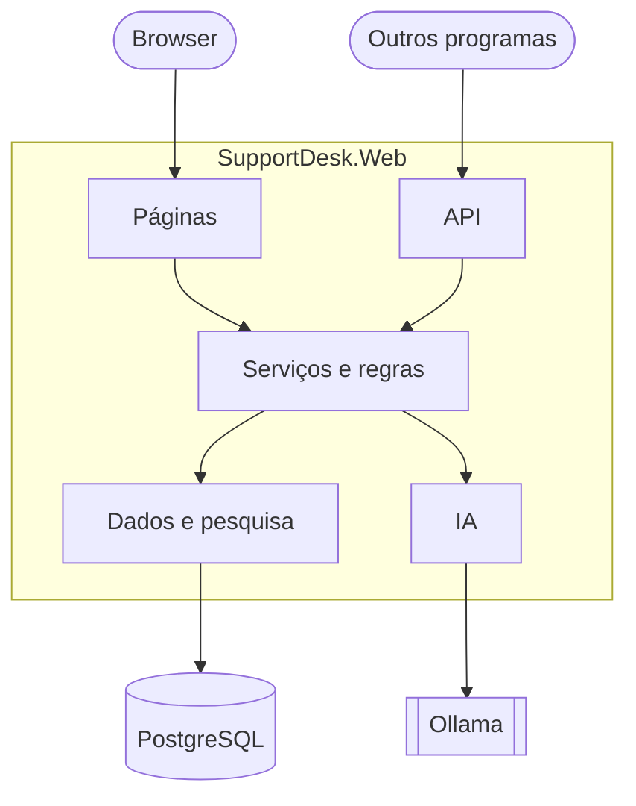

# SupportDesk AI

Uma aplicação de pedidos de suporte informático, daquelas a que se recorre quando a impressora não imprime ou a VPN não liga, com um assistente de IA que ajuda quem está do outro lado a responder.

Fiz este projeto para aprender a construir uma aplicação web completa em .NET e a juntar-lhe IA de forma útil. A ideia que o guia é simples: a IA dá uma ajuda, mas quem decide é sempre o técnico. Nada chega ao cliente sem uma pessoa ler primeiro. E o modelo corre na própria máquina, com o Ollama, por isso os pedidos dos clientes não saem dali.

## O que a aplicação faz

**Para quem pede ajuda**

- Cria uma conta, abre um pedido e acompanha-o até estar resolvido.
- Vê apenas os seus pedidos e pode comentá-los a qualquer momento.

**Para o técnico**

- Vê todos os pedidos, com filtro por estado, pesquisa e paginação.
- Muda o estado de um pedido (Aberto, Em curso, Resolvido), comenta e edita.
- Pede à IA uma sugestão de categoria, prioridade e resumo, e aceita ou rejeita.
- Pede um resumo de uma conversa longa: qual é o problema, o que já foi feito e o que falta saber.
- Pede um rascunho de resposta. A IA escreve-o só com o que encontra nos artigos da base de conhecimento e indica de que artigo tirou cada frase. O técnico lê, corrige o que for preciso e publica, ou deita fora.

**A base de conhecimento**

- Os artigos são ficheiros Markdown, fáceis de escrever e de corrigir.
- A pesquisa encontra-os pelas palavras e também pelo significado: «não consigo entrar» chega ao artigo sobre a conta bloqueada, mesmo sem palavras em comum.

**Quando alguma coisa falha**

- Se o Ollama estiver desligado ou lento, a aplicação continua a funcionar e explica o que se passa, em vez de mostrar uma página de erro.
- Cada pessoa tem um limite de pedidos à IA por minuto, para ninguém a ocupar sozinho.
- O endereço `/health` diz se a base de dados e o Ollama estão bem.

## Como está organizado



As páginas e a API usam os mesmos serviços, por isso as regras estão escritas uma única vez.

| Pasta | O que lá está |
|---|---|
| `src/SupportDesk.Web/Pages` | As páginas: pedidos, base de conhecimento, laboratório de IA e contas |
| `src/SupportDesk.Web/Controllers` | A API |
| `src/SupportDesk.Web/Services` | As regras dos pedidos e o acesso aos dados |
| `src/SupportDesk.Web/Authorization` | Quem pode fazer o quê a cada pedido |
| `src/SupportDesk.Web/AI` | Tudo o que fala com o modelo |
| `src/SupportDesk.Web/Knowledge` | A importação dos artigos e a pesquisa |
| `src/SupportDesk.Web/Articles` | Os artigos |
| `src/SupportDesk.Web/Data`, `Models`, `Migrations` | A base de dados |
| `tests/SupportDesk.UnitTests` | Os testes |
| `tools/SupportDesk.Evaluation` | A ferramenta que mede a qualidade da IA |
| `eval` | Os casos usados nessa medição |

## Com o que foi feito

| | |
|---|---|
| Aplicação | .NET 10, ASP.NET Core (Razor Pages e Web API) |
| Contas | ASP.NET Core Identity |
| Dados | PostgreSQL 18, EF Core, pgvector |
| IA | Ollama com `gemma3:4b` e `bge-m3`, através do Microsoft.Extensions.AI |
| Entrega | Docker e Docker Compose |
| Testes | xUnit |

## Experimentar

### A forma mais rápida: Docker

Precisas do Docker Desktop e, para a IA, do Ollama instalado no teu computador.

```powershell
git clone https://github.com/pmrmoreira/SupportDesk.git
cd SupportDesk
ollama pull gemma3:4b
ollama pull bge-m3
```

Na raiz, cria um ficheiro chamado `.env` com duas palavras-passe à tua escolha:

```
POSTGRES_PASSWORD=uma-palavra-passe
TECHNICIAN_PASSWORD=OutraPalavraPasse1
```

A do técnico tem de ter pelo menos 8 caracteres, com maiúsculas, minúsculas e algarismos. Depois:

```powershell
docker compose up --build -d
```

Abre http://localhost:8080 e entra com `tecnico@supportdesk.local` e a palavra-passe que escolheste. Já lá estão três pedidos de exemplo.

Antes de experimentares a pesquisa e os rascunhos, abre **Base de conhecimento** e carrega em **Importar artigos** e depois em **Gerar embeddings**.

Se a aplicação disser que não consegue ligar ao Ollama e ele estiver a correr, cria a variável de ambiente `OLLAMA_HOST` com o valor `0.0.0.0` no teu computador e reinicia o Ollama. Por omissão, ele só aceita ligações da própria máquina, e o contentor conta como outra.

### Sem Docker

Precisas do .NET SDK 10, do PostgreSQL 18 com a extensão pgvector e do Ollama.

```powershell
dotnet tool restore
dotnet user-secrets set "ConnectionStrings:SupportDesk" "Host=localhost;Port=5432;Database=supportdesk;Username=postgres;Password=A_TUA_PALAVRA_PASSE" --project src/SupportDesk.Web
dotnet user-secrets set "Seed:TechnicianEmail" "tecnico@supportdesk.local" --project src/SupportDesk.Web
dotnet user-secrets set "Seed:TechnicianPassword" "UmaPalavraPasse1" --project src/SupportDesk.Web
dotnet ef database update --project src/SupportDesk.Web
dotnet run --project src/SupportDesk.Web
```

A aplicação fica em http://localhost:5011.

## A API

Tudo o que se faz aos pedidos nas páginas também se pode fazer por API. É preciso um token, que se obtém em `POST /api/auth/login` com o email e a palavra-passe.

| Método | Caminho | O que faz |
|---|---|---|
| `GET` | `/api/tickets` | Lista os pedidos, com filtros e paginação |
| `GET` | `/api/tickets/{id}` | Mostra um pedido |
| `GET` | `/api/tickets/count` | Conta os pedidos |
| `GET` | `/api/tickets/stats` | Conta os pedidos por estado |
| `POST` | `/api/tickets` | Cria um pedido |
| `PUT` | `/api/tickets/{id}/status` | Muda o estado (só técnicos) |
| `GET` | `/api/tickets/{id}/comments` | Lista os comentários |
| `POST` | `/api/tickets/{id}/comments` | Acrescenta um comentário |

O ficheiro `src/SupportDesk.Web/SupportDesk.http` tem pedidos prontos a correr no Visual Studio.

## Testes e avaliação da IA

Os testes verificam as regras que têm sempre a mesma resposta, como as mudanças de estado, as permissões e a divisão dos artigos:

```powershell
dotnet test
```

Com a IA, a pergunta é outra: em quantos casos acerta? Há uma ferramenta que corre uma lista de casos e escreve um relatório com os resultados da classificação, da pesquisa e dos rascunhos:

```powershell
dotnet run --project tools/SupportDesk.Evaluation
```

Precisa do Ollama a correr e da base de conhecimento já importada.
